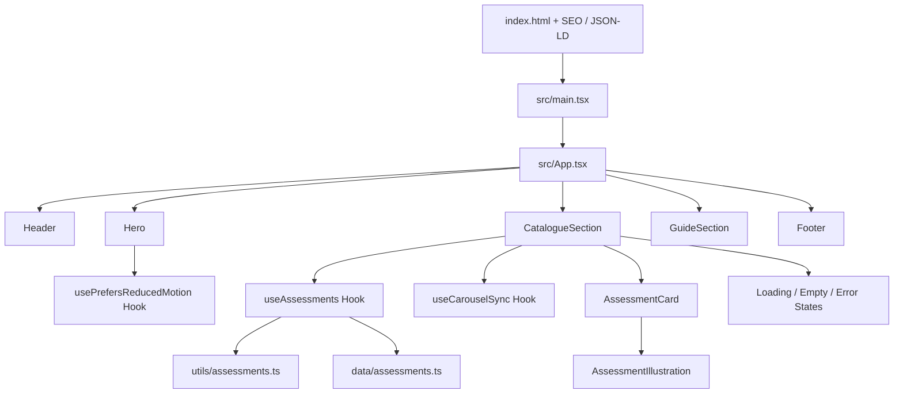

# Business Assessment Suite


A mobile-first editorial category landing page for the **Business Assessment Suite**, connecting HR teams, hiring managers, consultants, and coaches to three focused assessment tools:

1. **Behaviour Assessments** — psychometric framework analytics
2. **Aptitude Assessments** — structured talent evaluation platforms
3. **Personality Assessments** — advanced behavioral profiling analytics

---

## Architecture



---

## Local Setup

### Prerequisites

- **Node.js** `>= 20`
- **npm** `>= 10`

### Installation & Development

```bash
# 1. Install dependencies
npm install

# 2. (Optional) Copy environment template for custom static subpath testing
cp .env.example .env

# 3. Start development server on http://localhost:3000
npm run dev
```

### Verification Commands

```bash
# Run TypeScript typechecking
npm run lint

# Run Vitest + React Testing Library suite
npm test -- --run

# Build static production bundle into dist/
npm run build
```

---

## Deployment

Pushes to `main` trigger `.github/workflows/deploy.yml`, which runs typechecking, the automated Vitest suite, and builds `dist/` with the repository's GitHub Pages `base` path before publishing via `actions/deploy-pages`.

---

## Project Structure

```text
├── .github/workflows/deploy.yml   # Automated CI + GitHub Pages deploy
├── public/favicon.svg             # Geometric SVG favicon
├── src/
│   ├── components/                # Reusable UI sections, cards, SVG artwork & states
│   ├── data/assessments.ts        # Assessment tool definitions & guide mappings
│   ├── hooks/                     # Custom React hooks (catalogue, carousel, motion)
│   ├── test/setup.ts              # Vitest + jsdom environment setup
│   ├── types/assessment.ts        # Shared TypeScript interfaces
│   ├── utils/assessments.ts       # Pure validation & carousel calculation utilities
│   ├── App.tsx                    # Top-level page composition
│   ├── index.css                  # Tailwind CSS v4 + design tokens & dark mode
│   └── main.tsx                   # React root mount
├── index.html                     # Entry HTML with SEO metadata & ItemList JSON-LD
└── vite.config.ts                 # Vite + Vitest configuration
```
